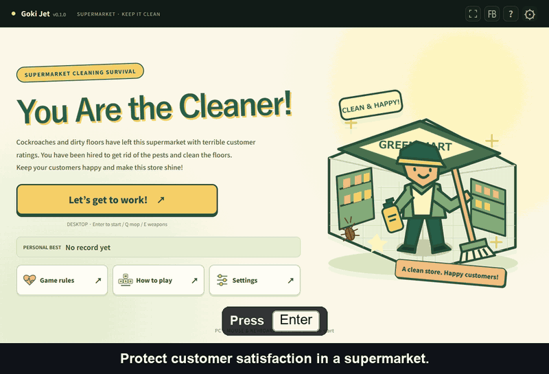

# あなたは清掃員 / Goki Jet

[English](README.md)

プレイURL: https://sogataro.github.io/goki-jet/

PCのChrome・Edge向け、一人称のスーパー清掃ゲーム。ゴキブリ退治と床清掃でお客さんの満足度を守り、0％になるまで続けます。

## 操作
Enterで開始・再開（3秒カウントダウン）。WASD/矢印移動、0.5秒長押しで走行、Spaceジャンプ、マウスで視点、左クリックで使用、右長押しでエイム。Qでモップ/直前武器、Eで攻撃武器切替。Esc停止。

## ルール
退治で20P・満足度＋5、清掃で10P・＋5。発見−10、客への攻撃−15/人。噴射30秒、残量0でも敗北しません。赤い販売機で100P補充、500/1000/1500/3000Pの順番で強化、2000Pで爆弾3個。1500Pは射程だけ強化、ショットガンは四角い照準内だけに当たります。

30秒ごと汚れ2か所、6か所以上が15秒続くごと満足度−10。120秒ごとレベルが上がり、3匹・客2人追加、速度×1.2。店舗×1.3拡張はLv2/3/10/20/30…だけ。60秒ごと中央に無料ガチャ。200P28％、5倍3匹20％、500P15％、10匹10％、1000P4％、2000P2％、5000P1％、ロケット3発20％。追加個体は再補充なし。満足度90％以上を30秒維持するごと100P。

## ローカル・公開
ビルド不要。`node server.cjs` → http://localhost:8019/ 。テストは`node --test`。静的ファイルをGitHub Pages（main直下）で配信します。共有QRは公開予定URLを指します。

## 保存
言語・感度・アシスト・音量・履歴閲覧・最高Lv/時間をブラウザに保存。途中状態は保存しません。設定から保存データを削除できます。

## Feedback / フィードバック
Use the FB button in the header. Your message, optional contact, app name/version and language are sent to the shared feedback service only when you press Send. Customer and gameplay data are not sent. / ヘッダーのFBから送信できます。送信時のみ本文・任意の連絡先・アプリ名/版/言語を共通受付へ送ります。

## ライセンス
MIT。Three.jsの表示はvendor/THREE-LICENSE.txt。効果音とタイトル絵は本ゲーム用の制作物です。

